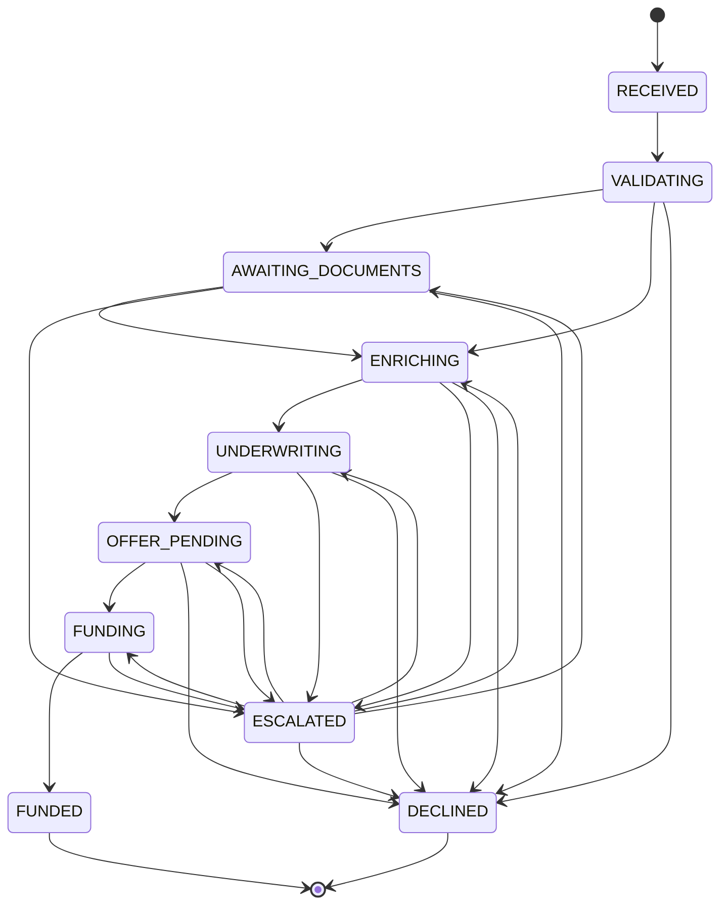

# Requirements: Loan Disbursement Orchestration on Temporal (2-hour scope)

> Give this file to Claude Code as the single source of truth. Build what is described here and nothing more. Items marked **DOC ONLY** are explained in `docs/DESIGN.md` with a diagram but **not coded**. Decisions listed here are already made; record them in the design doc, do not re-debate them.

---

## 0. Local setup (no real systems needed)

Everything runs on a laptop. Third parties are faked in code, the database is SQLite, and Temporal runs locally.

1. Install the Temporal CLI: `brew install temporal` (Mac), or download it from docs.temporal.io/cli, or use Docker: `docker run -p 7233:7233 -p 8233:8233 temporalio/temporal server start-dev`.
2. Start the server (terminal 1), registering the custom search attributes:
   ```
   temporal server start-dev \
     --search-attribute AppState=Keyword --search-attribute LoanProduct=Keyword \
     --search-attribute LoanChannel=Keyword --search-attribute SlaStatus=Keyword \
     --search-attribute SlaDeadline=Datetime
   ```
   The Web UI is at http://localhost:8233 and is part of the demo (operator visibility).
3. Python 3.11+, `pip install temporalio pytest pytest-asyncio ruff`.
4. Terminal 2: `make worker`. Terminal 3: `make demo SCENARIO=<name>`.

If the Temporal server cannot be downloaded or started in the environment you are working in, **do not mock Temporal**. Build and run everything that does not need it (section 10, tier 1), and state clearly in `README.md` and your final summary which checks were not run.

---

## 1. Context

A mid-sized bank takes personal-loan applications through three channels (self-serve portal, broker email, aggregator batch). Each must be ingested, validated, enriched (credit, identity, fraud), underwritten and funded within **48 hours**; today it takes about 4 days manually. Applications stall on missing documents, processors lose track, applicants abandon.

| # | Constraint |
|---|---|
| C1 | 8k apps/month now, 50k/month later |
| C2 | Products (personal, auto, debt consolidation) with distinct rules, documents, thresholds |
| C3 | Third parties have rate limits, partial failures, outages |
| C4 | Every decision (automated and human) is auditable |
| C5 | Some applications always need a human; escalate cleanly and resume after the decision |
| C6 | The lending team bills on **disbursed** loans |
| C7 | Every application ends **funded, declined, or escalated**; operators can see every application's status |

The design must answer these six questions (each gets a section in the design doc):
1. Reliable ingestion from three channels?
2. The lifecycle as a state machine?
3. Third-party failures, rate limits, partial failures?
4. Isolating product logic?
5. How do you know something is broken and how does an operator investigate?
6. How and when does a human enter the loop and how does the workflow resume?

---

## 2. Scope

| Area | **Build (code + tests)** | **DOC ONLY (explain + diagram)** |
|---|---|---|
| Channels | Portal (push) via `submit_portal_application` | Broker email polling and aggregator batch: one sequence diagram each plus the idempotency points |
| Products | **Personal** and **Debt consolidation** | **Auto**: describe LTV/collateral rules and how to add it |
| Workflow | Full application lifecycle, signals, update, query | SLA monitor, continue-as-new, versioning/patching, replay testing |
| Providers | Credit (with fallback), identity, fraud (all faked) | Real integrations, auth |
| Funding | Reserve, disburse, compensate | Real payment rails |
| Review | Update with validator plus a tiny CLI | Review UI, RBAC, four-eyes |
| Observability | Search attributes, status query, audit table | Prometheus/alerts, dashboards, runbook (as a short table) |
| PII | Inline applicant (demo) | Claim-check + payload codec in production |

---

## 3. Fixed technical decisions

- Python 3.11+, `temporalio` SDK. Use `@workflow.init`, typed search attributes, Update with validator, `workflow.all_handlers_finished`.
- Plain `@dataclass` models, `str`-based enums, money in integer cents, rates in basis points, tz-aware datetimes. No pydantic in workflow code.
- SQLite for audit log, read-model projection, review tasks, notification and funding ledgers. **Every write idempotent** (`INSERT OR IGNORE` on a deterministic key).
- Fake providers steered by `Applicant.demo_profile` tokens (marked DEMO ONLY): `prime`, `near_prime`, `outage_primary`, `outage_credit`, `ratelimit`, `fraud_flaky`, `id_unverified`, `funding_reject`.
- `timing_profile` (`prod` | `demo`) is a field on the workflow **input**, never read from env inside workflow code. `demo` shrinks hours to seconds.

---

## 4. Architecture

**One durable workflow per application.** `workflow_id == application_id == loan-<channel>-<external_ref>`. This deterministic id is the idempotency key for intake and the operator's lookup key.

Task queues (each is a separate scaling and failure domain):

| Queue | Hosts |
|---|---|
| `loan-orchestration` | workflow + light ops activities |
| `provider-credit` / `provider-identity` / `provider-fraud` | one provider each; set `max_task_queue_activities_per_second` (server-side, holds across all worker replicas) |
| `underwriting-personal` / `underwriting-debt_consolidation` | one product's rules each |
| `loan-funding` | reserve/disburse/release |

The workflow holds **no business rules and no I/O**. It sequences activities, timers, signals and updates.

---

## 5. State machine (question 2)

Implement as an explicit transition table in `state_machine.py`; the workflow calls `assert_transition` before every change. An illegal transition raises a plain `RuntimeError` (fails the workflow *task*, which retries after a fix, rather than failing the execution).



**Semantics (explain in docs):** `FUNDED` and `DECLINED` are terminal. `ESCALATED` means a named human owns the application with a timer-driven ladder; the workflow stays alive and resumes on their decision, so it is never limbo. `DECLINED` always carries a reason code (underwriting decline, invalid application, documents never provided, withdrawn, offer expired, reviewer decline, funding failure declined by reviewer).

**Guarantee:** no business path ends in Temporal status `Failed`. Unexpected activity failures are caught and escalated.

---

## 6. Workflow: `LoanApplicationWorkflow`

`run` validates, then loops over named stages, each returning the next stage: `DOCS → ENRICH → UNDERWRITE → OFFER → FUND`. A private `_Finish(state, reason)` exception unwinds to `run`, which sets the terminal state, runs `finalize_application`, waits for `all_handlers_finished` and returns `ApplicationResult`.

**DOCS.** Missing = `required_docs ∪ extra_docs − received` (empty if waived). If missing: state `AWAITING_DOCUMENTS`, send a request, wait up to `doc_reminder_interval`, send reminder N (idempotent key per reminder). After `max_doc_reminders`, escalate `DOCUMENTS_STALLED` (allowed: `APPROVE`=waive, `REQUEST_DOCS`, `DECLINE`). Never silently abandon.

**ENRICH.** Run credit, identity and fraud **in parallel** (`asyncio.gather(..., return_exceptions=True)`), each on its provider queue.
- *Partial-failure preservation:* only call providers whose result is not already stored. A completed credit pull is never repeated because fraud was down (cost, hard inquiries).
- Credit has an ordered fallback `bureau_primary → bureau_secondary`. `InvalidRequest` does not fall back.
- Still failing: `enrich_auto_rounds` automatic rounds separated by a durable sleep, then escalate `ENRICHMENT_UNAVAILABLE` (allowed `RETRY`, `DECLINE`). `RETRY` re-runs only the missing providers.

**UNDERWRITE.** Call the product's activity `underwrite_application` on the product queue; max 5 attempts, non-retryable `RulesError`. Audit the whole result. `AUTO_DECLINE` → `DECLINED` with reasons. `AUTO_APPROVE` → OFFER. `REFER` → escalate `UNDERWRITING_REFERRAL` (allowed `APPROVE`, `DECLINE`, `REQUEST_DOCS`), giving the reviewer the reasons, `rules_version`, `inputs_digest` and the indicative offer. Reviewer `REQUEST_DOCS` returns to DOCS without re-paying for enrichment.

**OFFER.** State `OFFER_PENDING`; send offer; wait for signal `accept_offer` for half of `offer_expiry`, one reminder, wait the rest; expiry → `DECLINED(OFFER_EXPIRED)`.

**FUND (saga).** `reserve_funds` then `disburse_funds` on `loan-funding`, idempotency key `<application_id>-disburse`, `schedule_to_close` about 2h, non-retryable `AccountRejected`.
- *Definitive failure (`AccountRejected`):* run `release_funds_reservation`, then escalate `FUNDING_REJECTED` (allowed `RETRY`, `DECLINE`).
- *Ambiguous failure (timeout/exhaustion):* do **not** compensate (money may have moved); escalate `FUNDING_UNCERTAIN`. `RETRY` is safe because of the idempotency key.
- Release must be a no-op against a `COMPLETED` disbursement.
- Success: audit `disbursed`, finish `FUNDED`.

**Finalize.** `finalize_application`: notify the applicant and, if `FUNDED`, **emit the billing event** (idempotent on application_id). This is what the lending team bills on.

**Handlers**

| Kind | Name | Behaviour |
|---|---|---|
| Signal | `document_uploaded(DocumentUpload)` | adds to received docs |
| Signal | `accept_offer(OfferAcceptance)` | honoured only in `OFFER_PENDING` |
| Signal | `withdraw(reason)` | all waits wake; finish `DECLINED(WITHDRAWN_BY_APPLICANT)`; ignored once funding starts |
| Update | `submit_review(ReviewDecision) -> ReviewAck` | the human decision (section 7) |
| Query | `status() -> ApplicationStatus` | state, product, channel, SLA deadline, missing docs, enrichment present, pending review, last 30 timeline entries |

All waits go through one helper `_wait(cond, timeout)` that also wakes on withdrawal and raises `asyncio.TimeoutError` on timeout. Durable sleeps use the same helper.

**Search attributes** (set at start, upserted on every transition): `AppState`, `LoanProduct`, `LoanChannel`, `SlaStatus`, `SlaDeadline`. `SlaDeadline = received_at + 48h` where `received_at` is channel-receipt time, so batch delays count against the SLA. Coding the SLA monitor that flips `SlaStatus` is **DOC ONLY**; set the attribute to `on_track` at start.

**Determinism rules:** no wall-clock, random, env, file or network access in workflow code; use `workflow.now()` and `workflow.sleep`. Audit sequence numbers come from a deterministic in-workflow counter so activity retries reuse the same key. Import activities and models inside `workflow.unsafe.imports_passed_through()`.

---

## 7. Human in the loop (question 6)

1. A stage calls `_escalate(reason, stage, allowed_actions, context)`.
2. The workflow sets `pending_review` (task id `<application_id>-review-<n>`), moves to `ESCALATED`, calls `create_review_task` (idempotent) and audits `review_requested`.
3. It durably waits. Escalation ladder: wait `review_ladder[0]`, notify L1 (`escalate_review_task`, audit), wait `review_ladder[1]`, notify L2, then wait indefinitely. **No auto-decision on timeout**: regulators expect an accountable human decision.
4. The reviewer calls the **Update** `submit_review`. The workflow audits `human_decision` (reviewer id, action, rationale), closes the task, clears `pending_review` and resumes the stage.

**Validator rejects synchronously (nothing written to history) when:** no review is pending; `task_id` is not the current task (stale); a decision was already submitted (double submit); `action` is not in `allowed_actions`; `reviewer_id` or a non-empty `rationale` is missing; `REQUEST_DOCS` has no `requested_docs`.

**Why Update, not Signal** (say so in the docs): the reviewer gets an immediate accept/reject so invalid decisions never vanish silently.

Withdrawal during review closes the task as `WITHDRAWN` and finishes the application.

**Review CLI** (`review_cli.py`): `list`, `show <app_id>` (Query), `approve|decline|request-docs|retry <app_id> --reviewer X --rationale "..."`; print validator rejections readably. Auth/RBAC/four-eyes are **DOC ONLY**.

---

## 8. Products and isolation (question 4)

**Decision:** separate *what to collect and how long to wait* (data) from *how to decide* (code).

- `policy.py`: workflow-safe, data-only `ProductPolicy` per product: required docs, amount/term limits, reminder interval/count, review ladder, offer expiry, provider deadline, auto-retry rounds, `underwriting_task_queue`. Has `prod` and `demo` timings. No I/O.
- `products/<product>.py`: implements `underwrite(req) -> UnderwritingResult`. Shared helpers (amortisation, DTI, input digest, offer builder) in `products/base.py` contain **no product rules**. Product modules never import each other.
- `products/registry.py`: `Product -> Underwriter`.
- `underwriting_activity_for(product)` returns an activity registered under the **same name** `"underwrite_application"`, bound to that product, with a guard that rejects a mismatched product with a non-retryable `RulesError`. Each product worker registers only its own. The workflow calls it by name and routes by `policy.underwriting_task_queue`.
- Every result carries `rules_version` (e.g. `personal@2026.11.0`) and `inputs_digest` (stable hash of the facts evaluated) so any decision can be reproduced.

**Personal.** Auto-decline: score < 580, fraud ≥ 0.9, DTI > 50%. Refer: identity unverified, fraud ≥ 0.3, score < 700, DTI > 36%, amount > $25,000. Else auto-approve. APR tiers by score.

**Debt consolidation.** Requires `creditor_statements`; `product_data.debts` = list of `{creditor, balance_cents, monthly_payment_cents}`. **Payouts go directly to the creditors**, which demonstrates that funding differs by product. Auto-decline: no debts, score < 600, fraud ≥ 0.9, DTI after removing replaced debts > 50%. Refer when the new payment is **not lower** than the payments it replaces, or score < 680, DTI > 40%, identity unverified, fraud ≥ 0.3.

**Auto (DOC ONLY).** Collateral-driven: LTV = amount / vehicle value, extra `vehicle_valuation` document. Show in the design doc the exact steps to add it: a module, a policy entry, a registry entry, a queue; **zero workflow changes**.

---

## 9. Activities

All idempotent, typed, with explicit timeouts. Sync activities need an `activity_executor`.

| Activity | Queue | Notes |
|---|---|---|
| `validate_application` | orchestration | amount/term within policy, income present, email valid |
| `pull_credit_report`, `verify_identity`, `score_fraud` | provider-* | take `request_id` idempotency key `<app_id>-<key>` (would be forwarded to the real provider) |
| `underwrite_application` | underwriting-<product> | via factory |
| `reserve_funds`, `disburse_funds`, `release_funds_reservation` | loan-funding | ledger table keyed by idempotency key; `disburse` returns the existing receipt if already `COMPLETED`; `funding_reject` profile raises `AccountRejected` |
| `record_event` | orchestration | append-only audit insert + monotonic projection upsert (only if new `seq` > stored) |
| `create_review_task`, `escalate_review_task`, `close_review_task` | orchestration | |
| `request_documents`, `send_offer`, `finalize_application` | orchestration | notifications deduped by deterministic key (`<app>-docs-<n>`, `<app>-offer-<n>`, `<app>-final`) |

**Portal intake.** `submit_portal_application(client, input)` starts the workflow with id = `application_id`, `id_reuse_policy=REJECT_DUPLICATE`, initial search attributes; on `WorkflowAlreadyStartedError` it returns the existing handle. Explain in docs why the portal starts the workflow directly while the other two channels poll.

**Error taxonomy** (a table in the design doc):

| Error | Retry | Workflow reaction |
|---|---|---|
| `ProviderUnavailable` | yes, backoff | after `provider_deadline`: fallback (credit) or count as failed, auto-round, then escalate |
| `RateLimited` | yes, honour `Retry-After` via `ApplicationError(next_retry_delay=...)` | same |
| `InvalidRequest` | no | no fallback; escalate |
| `AccountRejected` | no | compensate, escalate |
| `RulesError` or any unexpected `ActivityError` | no | caught by the stage-loop safety net, escalate with `RETRY`/`DECLINE` |

**Timeouts/retries** (table in docs with reasoning): internal idempotent writes 30s with **unlimited retries** (a DB outage should delay, never lose audit); providers 20s `start_to_close`, `schedule_to_close = provider_deadline`, exponential backoff capped 60s; funding `schedule_to_close` 2h; underwriting 5 attempts.

---

## 10. Tests

**Tier 1: no Temporal server needed (must pass anywhere)**
- Product rules: table-driven boundary tests per threshold for both products; amortisation; `inputs_digest` stable and sensitive to any change; debt-consolidation payouts equal creditor balances; products do not import each other.
- State machine: every legal transition accepted, illegal rejected, terminals have no exits, every non-terminal can reach a terminal.
- Activities called directly: idempotency (`record_event`, `create_review_task`, notifications, `disburse_funds` each produce a single effect when replayed); release does not undo a completed disbursement; projection never moves backwards on out-of-order `seq`; fake providers produce the documented failures.
- Static workflow validation: build `Worker`s for every queue with a **lazy client** (`Client.connect(..., lazy=True)`) so the workflow sandbox and registrations are exercised without a server.

**Tier 2: needs a server** (mark `@pytest.mark.temporal`, auto-skip with a clear message if none; use `WorkflowEnvironment.start_time_skipping()` so multi-hour timers run instantly). One test per demo scenario in section 11 asserting terminal state, reason code, audit trail content and provider call counts. Plus HITL validator tests (stale, double submit, disallowed action, missing rationale) and a "never `Failed`" test that injects an unexpected activity failure and expects escalation.

Quality: type hints, `ruff` clean, a one-line "why" comment on every non-obvious decision (this will be walked through live).

---

## 11. Demo scenarios (`demo.py`, `timing_profile="demo"`, each under ~1 minute)

| Name | Shows |
|---|---|
| `happy` | prime personal loan, auto-approve, accept, funded, billing event emitted |
| `review` | near-prime refers to ESCALATED, reviewer Update (also show a rejected stale/double update), resume, funded |
| `outage` | `outage_primary`: bureau fallback, funded |
| `partial` | `fraud_flaky`: credit retained and called once, only fraud retried |
| `funding_fail` | `funding_reject`: compensation, escalate, reviewer decision |

Each prints a short narrative: transitions, what the operator sees (status query plus search-attribute query), and the audit trail. Also include a duplicate-submission check inside `happy` (submit the same portal ref twice, expect one workflow).

---

## 12. Documentation

**`README.md`:** section 0 setup, `make dev-server | worker | demo | test`, how to open the UI and paste the example queries, how to run tests, and a 10-line "what you are looking at".

**`docs/DESIGN.md`**, in this order:
1. Problem and SLA budget (where the 48h goes; which stages are timer-bound vs human/applicant-bound).
2. Architecture overview (diagram).
3. Answers to the six questions, each with mechanism, alternatives considered and why rejected. Broker/aggregator ingestion is described here (**DOC ONLY**): persist the raw payload first, canonicalise, dead-letter bad records, start with deterministic id (duplicate delivery = no-op), ack the source only after start succeeds; broker via a Temporal Schedule (overlap `SKIP`), aggregator as one workflow per batch id with paging and continue-as-new.
4. Workflow walk-through and determinism rules.
5. Activity catalogue with timeouts/retries and reasoning, plus the error taxonomy.
6. HITL design.
7. Product isolation and "how to add a product" (use Auto as the worked example).
8. **Failure-mode matrix:** provider down, rate limit, worker crash mid-activity, worker crash mid-workflow, DB down, duplicate delivery, reviewer double-click, applicant ghosts, funding timeout, bad deploy. For each: what happens and why nothing is lost or duplicated.
9. Observability and operations: the search-attribute queries (below), the alerts you would set (task-queue schedule-to-start latency, workflow task and activity failure rates, retries per provider, escalated-too-long, dead letters), and a short "operator investigates X" table. SLA monitor and versioning/replay-testing strategy are explained here (**DOC ONLY**).
10. Audit and compliance: the audit table (append-only, keyed `(application_id, seq)`) is the **system of record**, not Temporal history (limited retention). Required events: state changes, provider results/failures/fallbacks, underwriting decision with `rules_version` and `inputs_digest`, review requested/escalated, human decision (reviewer, action, rationale), offer accepted, disbursed.
11. Capacity: 50k/month is about 1.1 apps/minute; about 3,300 open workflows steady state; the real limits are provider quotas and batch bursts. What changes at 10x.
12. **Trade-offs table** (mandatory; the brief asks): one workflow type with product policy vs a workflow per product; rules as activities on product queues vs in workflow code; Update vs Signal; no auto-decision on review timeout vs auto-decline; audit table vs Temporal history as record; inline PII vs claim-check + codec; SQLite vs real stores; polling vs event-driven intake; invalid broker data declined with reason rather than routed to a data-fix queue (first extension); human `APPROVE` approves the indicative offer only, no term override (second extension).
13. Out of scope and future work.

**Operator queries to include verbatim (UI search syntax):**
- `AppState = "ESCALATED" AND ExecutionStatus = "Running"`
- `SlaStatus IN ("at_risk","breached") AND ExecutionStatus = "Running"`
- `LoanProduct = "debt_consolidation" AND AppState = "ENRICHING"`
- `ExecutionStatus IN ("Failed","TimedOut","Terminated")` (should be empty)

**`docs/DIAGRAMS.md`** (Mermaid, all must render): (1) architecture/context, (2) state machine from section 5, (3) workflow stage flowchart with escalation exits, (4) broker and aggregator ingestion sequence diagrams showing idempotency points, (5) enrichment with parallel calls, fallback and partial-failure retention, (6) HITL sequence with the validator accept and reject paths, (7) funding saga with compensation and the ambiguous branch, (8) task-queue and worker topology showing product isolation and rate limits.

---

## 13. Repository layout

```
loan-temporal/
  README.md  docs/CLAUDE_PLAN.md  pyproject.toml  Makefile
  docs/ DESIGN.md  DIAGRAMS.md
  loan_origination/
    models.py  policy.py  state_machine.py  search_attrs.py
    store.py   fake_providers.py
    products/   base.py personal.py debt_consolidation.py registry.py
    activities/ providers.py underwriting.py funding.py ops.py
    workflows/  application.py
    intake.py            # submit_portal_application
    worker.py            # one Worker per queue; --queues a,b,c to run as separate processes
    review_cli.py
    demo.py
  tests/
```

`worker.py`: workflows on the orchestration queue; provider activities on provider queues with `max_task_queue_activities_per_second`; one underwriting worker per product registering only that product's activity; funding on its own queue; `ThreadPoolExecutor` for sync activities.

---

## 14. Definition of done

1. With the dev server running, `make worker` and `make demo SCENARIO=<each of the 5>` end in the expected terminal state.
2. `make test` passes tier 1 with no server; tier 2 passes when a server is available and is skipped with a message otherwise.
3. No scenario ends in Temporal status `Failed`.
4. Restarting the worker mid-`happy` run does not lose or duplicate any effect: exactly one `COMPLETED` disbursement and one billing event.
5. A duplicate portal submission yields one workflow.
6. Every terminal application has an ordered audit trail with `rules_version`, `inputs_digest` and, where relevant, reviewer id and rationale.
7. An operator can answer "where is X, why, who owns it?" using only the documented UI queries and the CLI.
8. Adding Auto is described so completely in the docs that it needs no workflow change.
9. All diagrams render in a Mermaid previewer; DESIGN.md has the trade-offs table and failure-mode matrix.

---

## 15. Working agreements for Claude Code

- Order: models/policy/state machine → store/fake providers → products + tests → activities + tests → workflow → worker → intake + review CLI → demo → docs/diagrams → tier-2 tests. Run the applicable tests after each step and fix before moving on.
- Do not add dependencies beyond `temporalio`, `pytest`, `pytest-asyncio`, `ruff`.
- Do not expand scope. If something is marked DOC ONLY, write it up, do not code it.
- If a requirement conflicts with an SDK constraint you discover, keep the intent, pick the closest compliant implementation and record it under "Deviations" in DESIGN.md.
- Finish with a summary: what was built, what was verified, what could not be run, and the three trade-offs most worth discussing in the interview.
