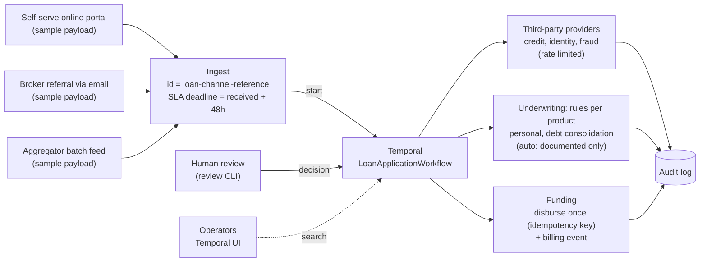
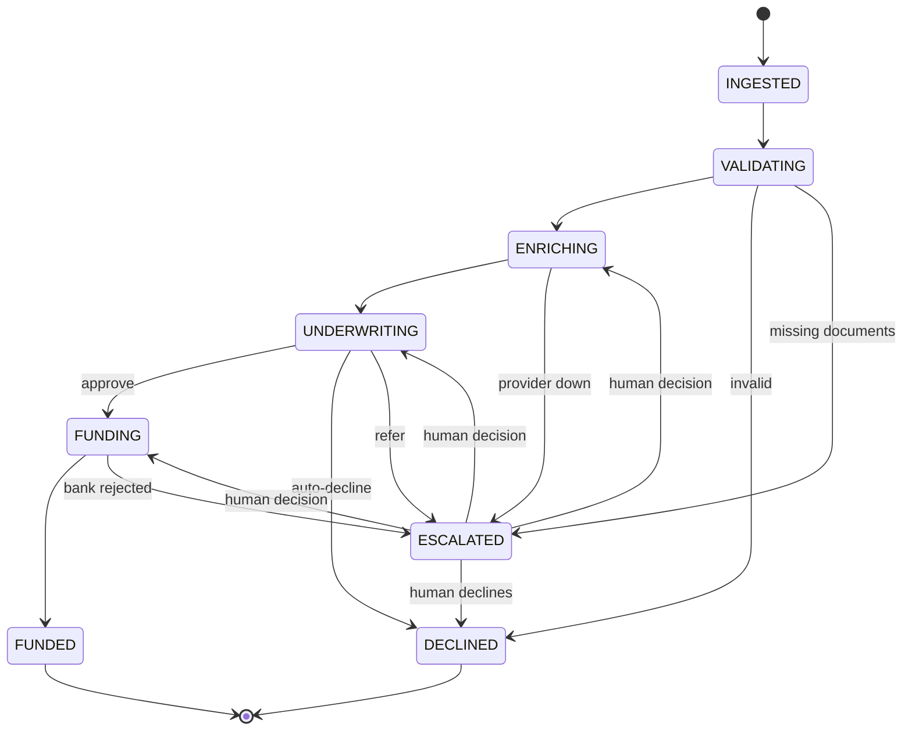
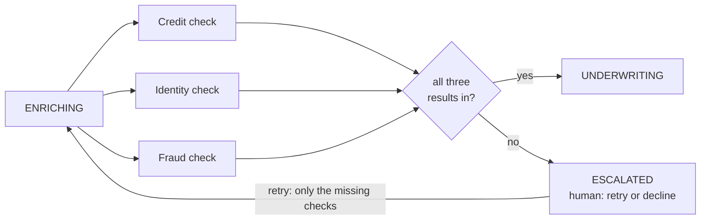
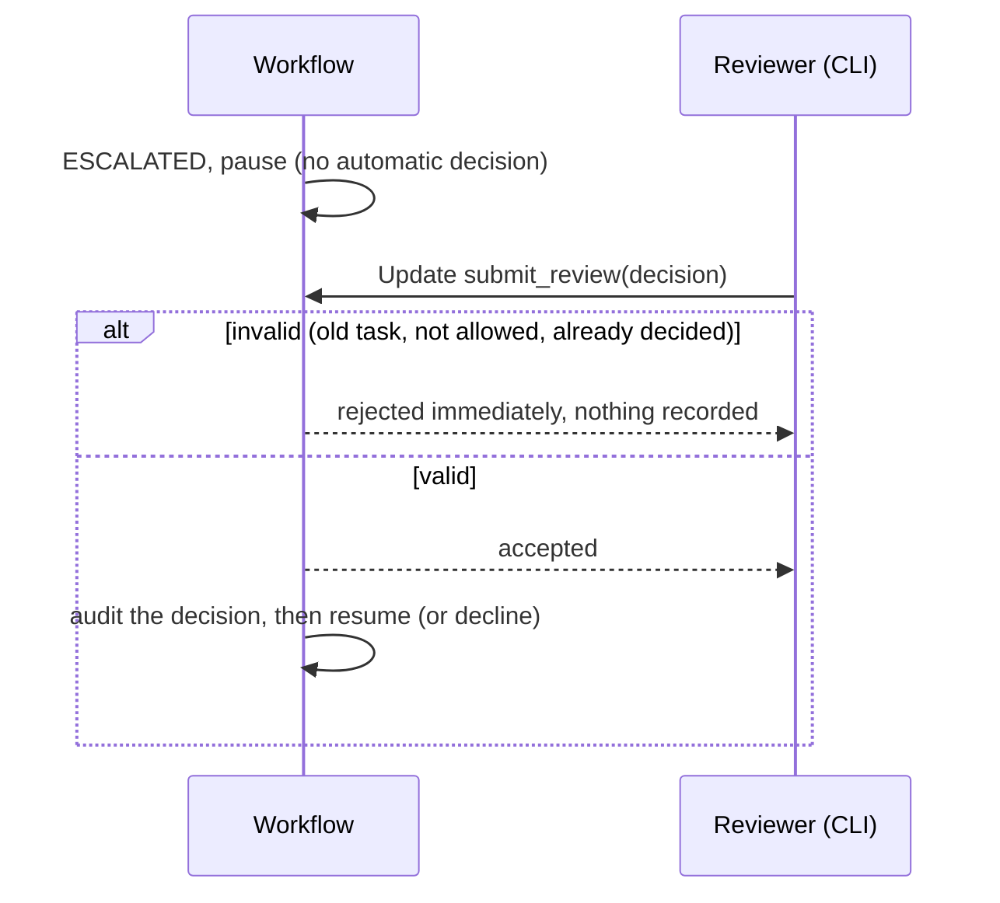

# Diagrams

The same four diagrams are in [loan-diagrams.excalidraw](loan-diagrams.excalidraw) (open it at excalidraw.com with Menu → Open). These Mermaid versions render on GitHub and in VS Code's Markdown preview.

## 1. Architecture

## 2. Application lifecycle (state machine)

Any unexpected error also goes to ESCALATED, so no application ends as a failed workflow.

## 3. Third-party providers: rate limits, partial failures, outages

Each check retries with backoff on its own rate-limited task queue before the workflow escalates.

## 4. Human-in-the-loop

